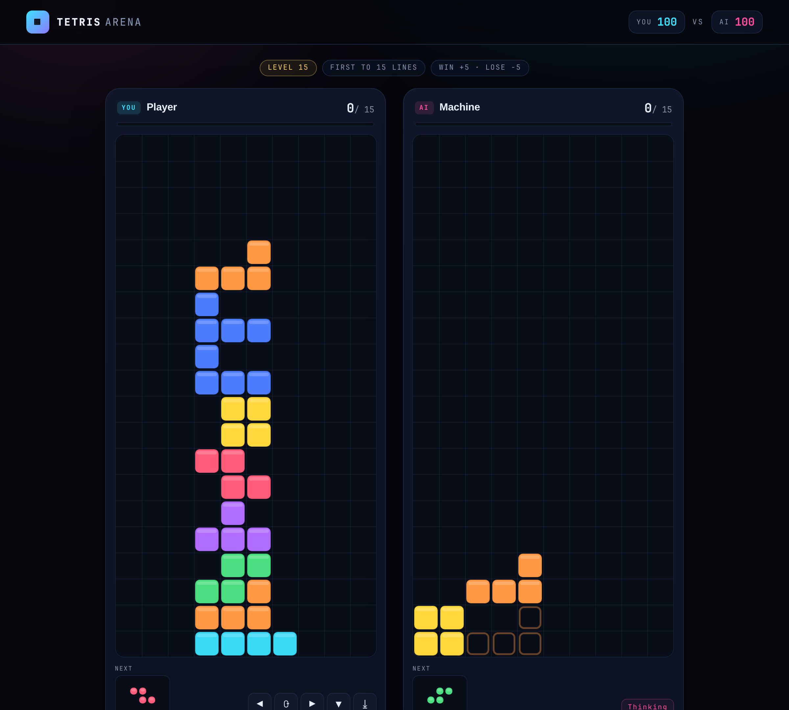

# Tetris Arena

> Race an AI opponent to 15 lines at level-15 gravity. Win and your rating climbs; lose and it slips. No frameworks, no build step — just Node.js and the browser.

[](https://nodejs.org)
[](LICENSE)
[](#testing)
[](package.json)

---

## Table of contents

- [Features](#features)
- [Screenshot](#screenshot)
- [Quick start](#quick-start)
- [How to play](#how-to-play)
- [Rules & scoring](#rules--scoring)
- [The AI opponent](#the-ai-opponent)
- [Project structure](#project-structure)
- [Architecture](#architecture)
- [HTTP API](#http-api)
- [Configuration](#configuration)
- [Testing](#testing)
- [Technical notes](#technical-notes)
- [Contributing](#contributing)
- [License](#license)

---

## Features

- **Head-to-head Tetris** — you versus an AI, both playing the full game simultaneously.
- **Level 15 gravity** — 125 ms per cell; the board fills up fast.
- **Deterministic-feeling piece flow** — 7-bag randomizer with a live next-piece preview.
- **Heuristic AI** — evaluates every rotation and column, scores the result, and intentionally plays imperfectly so matches stay winnable.
- **Persistent ratings** — stored server-side in `data/scores.json`; both sides start at 100 and move ±5 per match.
- **Full input support** — keyboard, and on-screen touch buttons for mobile.
- **Zero dependencies** — only Node's built-in `http`, `fs`, and `node:test`. No bundler, no framework.
- **Responsive UI** — dual-board layout for desktop, stacked layout on narrow screens.
- **Hardened static server** — path-traversal protection, request size limits, and atomic data writes.

## Screenshot



## Quick start

Requires **Node.js 18 or newer** (tested on Node 26).

```bash
git clone https://github.com/<your-username>/tetris-arena.git
cd tetris-arena
npm start
```

Then open **http://127.0.0.1:3000**.

For development with automatic restarts on file changes:

```bash
npm run dev
```

## How to play

| Action       | Keys                  |
| ------------ | --------------------- |
| Move left    | `←`                   |
| Move right   | `→`                   |
| Soft drop    | `↓` (hold)            |
| Rotate CW    | `↑` or `X`            |
| Rotate CCW   | `Z`                   |
| Hard drop    | `Space`               |

On touch devices, use the five on-screen buttons under your board: ◀ ⟳ ▶ ▼ ⤓.

A ghost piece shows where the current tetromino will land. A countdown (`3 · 2 · 1 · GO`) starts each match.

## Rules & scoring

- **Win** by clearing **15 lines** before the AI, or by surviving while the AI tops out.
- **Lose** by topping out first, or if the AI reaches 15 lines first.
- Both players start at a **rating of 100**. Each match moves the winner **+5** and the loser **−5**.
- Ratings and the last 20 matches are persisted to `data/scores.json` through the server.
- Line-clear scoring uses the classic table scaled by level: `100 / 300 / 500 / 800 × 15` for 1–4 lines.
- Soft and hard drops award small bonuses (1 point per cell dropped softly, 2 per cell hard-dropped) for feedback only — the match is decided by lines, not score.

## The AI opponent

The AI is a one-ply search over every rotation × column combination, scored with a Dellacherie-style board heuristic. For each candidate placement it simulates the lock and any line clears, then computes:

```
score = 0.760666 × lines_cleared
      − 0.510066 × aggregate_height
      − 0.356630 × holes
      − 0.184483 × bumpiness
```

- **aggregate height** — sum of column heights (keeps the stack low).
- **holes** — empty cells buried under filled cells (strongly penalized).
- **bumpiness** — total height difference between adjacent columns (favors a flat surface).

To keep it beatable, `findBestPlacement` occasionally deviates from the optimal move:

- ~6% of the time it picks randomly among the top 8 options.
- ~24% of the time it picks a near-best option (2nd–4th).

The AI "thinks" for 240 ms, then commits one action every 75 ms, so you can watch it rotate and slide pieces into place. All of this lives in [`public/engine.js`](public/engine.js) and is fully unit-tested.

## Project structure

```
tetris-arena/
├── server.js              # Node HTTP server: static files + JSON API
├── package.json           # Scripts, metadata, Node engine requirement
├── lib/
│   └── store.js           # Persistent rating/match store (atomic JSON writes)
├── public/
│   ├── index.html         # Markup: boards, HUD, overlays, touch controls
│   ├── styles.css         # Dark neon theme, responsive layout
│   ├── engine.js          # Core rules: board, pieces, gravity, locks, AI search
│   └── game.js            # Browser glue: canvas rendering, input, match loop
├── test/
│   └── engine.test.js     # Unit tests for the engine and AI (node:test)
├── docs/
│   └── screenshot.png     # Gameplay screenshot used in this README
├── data/
│   └── scores.json        # Runtime state (ratings + match history, gitignored)
├── CONTRIBUTING.md        # Dev setup, style guide, PR process
├── LICENSE                # MIT
└── README.md              # You are here
```

### Module responsibilities

| File | Runs in | Responsibility |
| --- | --- | --- |
| `public/engine.js` | Browser + Node tests | Pure game logic: constants, tetromino shapes, rotation cache, collision, `TetrisGame`, `findBestPlacement`. |
| `public/game.js` | Browser | DOM/canvas rendering, input handling, `AiController`, match lifecycle, API calls. |
| `server.js` | Node | Static file serving, routing, request parsing, JSON responses. |
| `lib/store.js` | Node | Load/normalize/persist state, record results, reset ratings. |

## Architecture

```
┌──────────────────────────── Browser ────────────────────────────┐
│                                                                  │
│  index.html + styles.css                                         │
│        │                                                         │
│        ▼                                                         │
│  game.js ── imports ──► engine.js                                │
│    │  │                    │                                     │
│    │  │                    ├─ TetrisGame (player)                │
│    │  │                    ├─ TetrisGame (AI)                    │
│    │  │                    └─ findBestPlacement (AI search)      │
│    │  │                                                          │
│    │  └─ requestAnimationFrame loop ─► canvas draw + HUD         │
│    │                                                             │
│    └─ fetch("/api/...") ───────────────┐                         │
└────────────────────────────────────────┼─────────────────────────┘
                                         ▼
┌──────────────────────────── Node server ─────────────────────────┐
│  server.js                                                       │
│    ├─ GET  /api/state    → current ratings + matches             │
│    ├─ POST /api/result   → record a match, return new state      │
│    ├─ POST /api/reset    → reset ratings to 100                  │
│    └─ GET  /*            → serve public/ (path-traversal safe)   │
│                                                                  │
│  lib/store.js ──► data/scores.json  (atomic temp-file + rename)  │
└──────────────────────────────────────────────────────────────────┘
```

The game loop is intentionally simple:

1. `startMatch()` builds two `TetrisGame` instances and an `AiController`, runs the countdown, then starts `requestAnimationFrame(loop)`.
2. Each frame computes `dt` (clamped to 100 ms), ticks gravity for both games, lets the AI act, drains clear-flash effects, and redraws both boards.
3. `checkWinner()` ends the match on 15 lines or a top-out.
4. `endMatch()` shows the result overlay and `POST`s to `/api/result`; the server is the source of truth for ratings.

## HTTP API

All responses are JSON with `cache-control: no-store`.

### `GET /api/state`

Returns the persisted state.

```json
{
  "player": 100,
  "ai": 100,
  "matches": []
}
```

### `POST /api/result`

Records one match. Body:

```json
{
  "winner": "player",
  "playerLines": 15,
  "aiLines": 9
}
```

- `winner` must be `"player"` or `"ai"` (otherwise `400`).
- Ratings move ±5; the match is prepended to `matches` (capped at 20).
- Responds with the updated state plus the recorded `match`.

```json
{
  "player": 105,
  "ai": 95,
  "matches": [
    {
      "id": "m9k2x1-a4f2",
      "at": "2026-11-12T19:26:00.000Z",
      "winner": "player",
      "delta": 5,
      "playerLines": 15,
      "aiLines": 9
    }
  ],
  "match": { "id": "m9k2x1-a4f2", "...": "..." }
}
```

### `POST /api/reset`

Resets both ratings to 100 and clears match history.

```json
{ "player": 100, "ai": 100, "matches": [] }
```

Request bodies are capped at **16 KiB**; oversized payloads return `500` with `{ "error": "internal error" }` and the rejection is logged.

## Configuration

| Variable | Default     | Description                      |
| -------- | ----------- | -------------------------------- |
| `PORT`   | `3000`      | HTTP port to listen on           |
| `HOST`   | `127.0.0.1` | Interface to bind (`0.0.0.0` to expose on your network) |

```bash
PORT=8080 HOST=0.0.0.0 npm start
```

## Testing

The engine is pure and framework-free, so tests run directly with Node's built-in runner — no install step.

```bash
npm test
```

Current coverage includes:

- all seven tetrominoes expose four rotation states,
- wall/floor collision detection,
- hard drop locking and spawning the next piece,
- completed-row clearing and line counting,
- gravity + lock delay behavior,
- the AI completing an available line,
- AI placements staying in-bounds for every piece type,
- a 40-piece AI stacking stress test without crashes.

## Technical notes

- **No build tooling.** Native ES modules are loaded directly by the browser via `<script type="module">`; the same `engine.js` is imported by Node tests.
- **7-bag randomizer.** Each bag contains one of every tetromino, shuffled. The engine accepts an injectable RNG, which is how tests stay deterministic.
- **Rotation cache.** Rotation states are computed once per piece type and memoized, with simple wall kicks (`±1`, `±2`, and one upward kick).
- **Lock delay.** A piece resting on the stack locks after 420 ms; moving or rotating resets the timer, up to the point of collision.
- **Crisp rendering.** Canvases are sized to `devicePixelRatio` (capped at 2) and drawn with a scaled context, so blocks stay sharp on HiDPI screens.
- **Atomic persistence.** `lib/store.js` writes to a temp file and `rename`s it into place, avoiding partial writes. State is cached in memory after the first read.
- **Static file safety.** Requests are decoded and `path.normalize`d; anything resolving outside `public/` returns `403`.

### Tuning knobs

| Constant | File | Effect |
| --- | --- | --- |
| `LEVEL` / `GRAVITY_MS` | `public/engine.js` | Overall drop speed |
| `TARGET_LINES` | `public/engine.js` | Lines needed to win |
| `LOCK_DELAY_MS` | `public/engine.js` | How long a grounded piece waits |
| `aiThinkMs` / `aiActionMs` | `public/game.js` | AI delay per piece / per action |
| Heuristic weights | `public/engine.js` | AI stack-quality preferences |
| Mistake probabilities | `public/engine.js` | How fallible the AI is |

## Contributing

Contributions are welcome. See [CONTRIBUTING.md](CONTRIBUTING.md) for development setup, coding guidelines, and the pull-request process.

## License

Released under the [MIT License](LICENSE).

Tetris is a registered trademark of The Tetris Company. This project is an independent fan implementation for educational purposes and is not affiliated with or endorsed by The Tetris Company.
